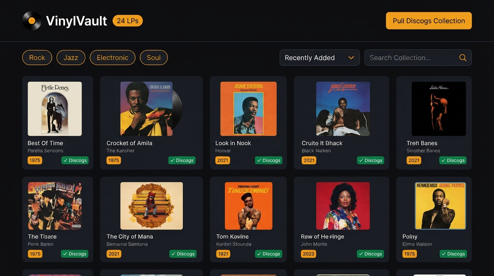
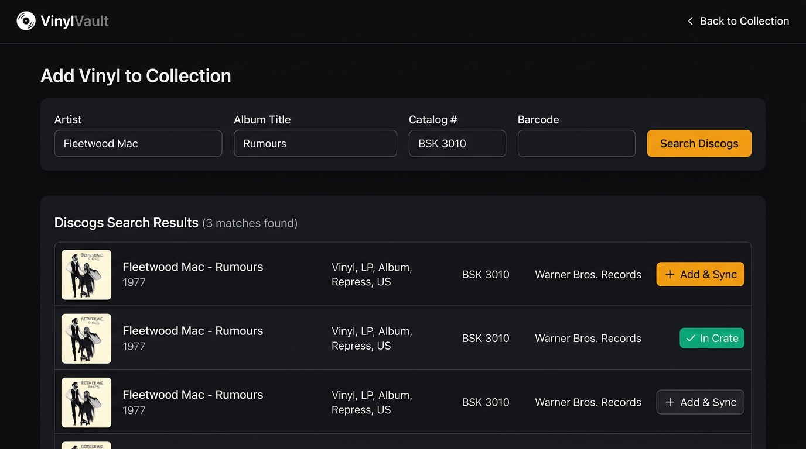
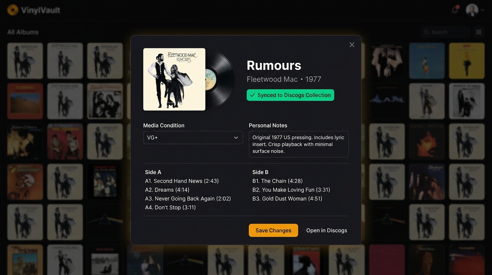
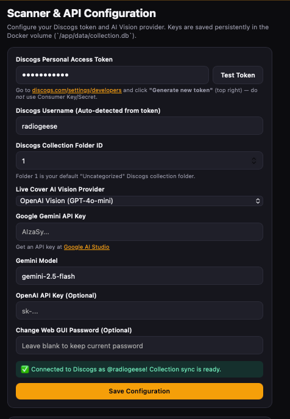

# 🎵 VinylVault — Discogs Vinyl Record Collection Manager

**VinylVault** is a self-hosted, Dockerized web application for cataloging and managing your vinyl record collection with **two-way Discogs Collection synchronization** and **local album cover caching**.

Search the Discogs database by Artist, Album Title, Catalog Number (`Cat#`), or Barcode, add records to your local SQLite crate (which automatically syncs them to your remote Discogs account), or pull your entire existing Discogs Collection with a single click.

---

## 📸 Screenshots

### 1. Vinyl Collection Crate & One-Click Discogs Import
Browse, filter, and sort your vinyl records by recently added, artist, title, or release year. Album covers are downloaded from Discogs and cached permanently on disk (`/app/data/covers`), with a **`✓ Discogs`** badge indicating records synced with your Discogs account.



---

### 2. Manual Discogs Search & Add (`+ Add & Sync`)
Search Discogs by **Quick Search**, **Artist**, **Album Title**, **Catalog Number**, or **Barcode**. Clicking **`+ Add & Sync`** fetches the full release details and tracklist, caches the cover art locally, and adds the release directly to your Discogs Collection folder.



---

### 3. Album Details, Tracklist & Condition Grading
Click any record in your crate to view its full vinyl tracklist, release metadata, Discogs link, media/sleeve condition grading (`M`, `NM`, `VG+`, `VG`, `G+`), and personal pressing notes.



---

### 4. Settings & Discogs Token Verification
Configure and test your **Discogs Personal Access Token** right in the Web GUI. VinylVault automatically detects your Discogs username via `/oauth/identity` and stores your settings persistently in SQLite.



---

## ✨ Key Features

- **🔄 Two-Way Discogs Collection Sync**:
  - **Pull Existing Collection**: Import all vinyl releases from your existing Discogs account (`GET /users/{username}/collection/folders/0/releases`) with one click, including high-resolution album artwork.
  - **Push New Additions**: Adding an album in VinylVault automatically adds it to your remote Discogs Collection (`POST /users/{username}/collection/folders/{folder_id}/releases/{release_id}`).
  - **Synced Removal**: Removing an album from your local crate also removes that instance from your Discogs Collection.
- **🔍 Precision Manual Search**:
  - Look up specific vinyl pressings by **Artist**, **Album Title**, **Catalog Number** (e.g., `BSK 3010`), **Barcode**, or free-text query.
- **🖼️ Permanent Local Cover Art & SQLite Storage**:
  - Album covers, tracklists, genres, styles, release years, condition grades, and personal notes are stored locally in `/app/data/collection.db` and `/app/data/covers` so your collection loads fast and works offline.
- **🔒 Password-Protected Web GUI**:
  - Built-in PIN/password login screen (default: `vinyl123`, configurable via `APP_PASSWORD` or the in-app **Settings** tab) with HTTP (`3000`) and HTTPS (`3443`) support.

---

## 🚀 Quick Start with Docker Compose

### 1. Configure Environment (Optional)
Copy `.env.example` to `.env` (or configure everything directly inside the Web GUI **Settings** tab after starting):

```bash
cd /Users/matthew/.gemini/antigravity/scratch/vinyl-scanner
cp .env.example .env
```

| Environment Variable | Default | Description |
| :--- | :--- | :--- |
| `APP_PASSWORD` | `vinyl123` | Password / PIN to unlock the Web GUI |
| `SESSION_SECRET` | `change-this-secret-in-prod` | HMAC secret used to sign login sessions |
| `DISCOGS_TOKEN` | *(empty)* | Your Discogs Personal Access Token (can also be set in the UI) |
| `PORT` | `3000` | HTTP Web GUI port |
| `HTTPS_PORT` | `3443` | HTTPS Web GUI port (auto-generated self-signed TLS cert) |

### 2. Build & Start the Container

```bash
docker compose up -d --build --remove-orphans
```

### 3. Connect Your Discogs Account & Pull Your Collection
1. Open **`http://localhost:3000`** (or **`https://localhost:3443`**) and log in with your password (default: `vinyl123`).
2. Go to the **Settings** tab.
3. Generate a free **Personal Access Token** at [discogs.com/settings/developers](https://www.discogs.com/settings/developers) (click **"Generate new token"** in the top-right corner).
4. Paste the token into **Discogs Personal Access Token**, click **Test Token**, and click **Save Configuration**.
5. Click **⬇ Pull Discogs Collection** in the top header (or in **Settings**) to import all of your existing Discogs records and artwork!

---

## 📁 Project Structure

```text
vinyl-scanner/
├── Dockerfile               # Node 20 Alpine image with SQLite build toolchain
├── docker-compose.yml       # Single-container service definition with ./data volume
├── .env.example             # Example environment variables
├── package.json             # Dependencies (express, better-sqlite3, cookie-parser, selfsigned)
├── docs/
│   └── screenshots/         # UI screenshots referenced in README.md
├── public/
│   ├── index.html           # Responsive dark-mode Web GUI (Collection, Add Album, Settings)
│   ├── styles.css           # Application styling
│   └── app.js               # Frontend state, search, collection grid, and Discogs sync logic
└── src/
    ├── server.js            # Express HTTP/HTTPS server & REST API routes
    ├── discogs.js           # Discogs API client (search, release details, collection pull/push)
    ├── db.js                # SQLite schema, migrations, and CRUD helpers
    └── certs.js             # Self-signed TLS certificate generator for LAN HTTPS access
```
